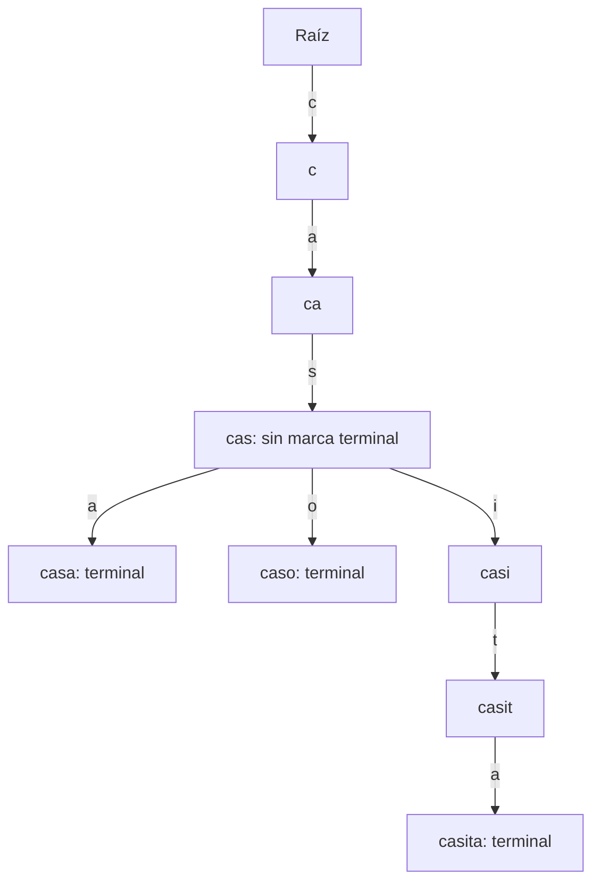

# Desmarcar y podar sin borrar palabras que comparten un prefijo

[Lección](README.md) · [Índice del módulo](../README.md) · [Recorridos ejecutables](../../laboratorios/recorridos/README.md)

## 1. Distingue un camino de una clave almacenada

Una ruta de letras puede existir para sostener palabras más largas sin ser terminal. El ejemplo inicial guarda casa, casita y caso; cas existe como camino pero no como palabra. El recorrido ampliado inserta también cas, para que puedas observar qué cambia al retirar solo su marca terminal.

Esta forma simplificada muestra la estructura después de eliminar cas:



## 2. Sigue el retorno de eliminar

El método recursivo baja hasta el final y desmarca terminal. Devuelve si ese nodo quedó sin marca y sin hijos. Su padre retira el enlace solo cuando ambas condiciones lo permiten. Este retorno comunica si una rama dejó de ser necesaria, no si toda la palabra compartida debe desaparecer.

Eliminar cas deja intactos sus hijos a, i y o. Eliminar casita retira su tramo exclusivo i→t→a; conserva casa y caso. Si se conservaran todos los nodos vacíos, el resultado de búsqueda podría seguir correcto pero la estructura retendría memoria innecesaria. Si se podara antes de comprobar descendientes, se perderían palabras válidas.

## 3. Examina la raíz como caso de borde

La palabra vacía se representa con terminal en la raíz. Agregarla hace contiene("") verdadero y la enumera primero en prefijo(""). Eliminarla quita esa marca, pero no elimina las ramas de las demás palabras. El prefijo vacío y la palabra vacía son preguntas distintas: el primero pide enumeración desde la raíz.

El recorrido imprime palabras entre comillas para distinguir una cadena vacía de una lista vacía. Después de agregarla se observa ['', 'casa', 'caso']; después de retirarla quedan ['casa', 'caso'].

## 4. Valida antes de cambiar la estructura

[Trie](../../src/curso/Trie.java) admite únicamente letras ASCII a-z y longitud máxima 80. Árbol con acento, CASA y longitud 81 se rechazan. La longitud 80 sí se acepta. El dominio es una decisión explícita de esta implementación; el catálogo usa otra normalización y no debe confundirse con este trie.

## 5. Repite la secuencia y explica el costo

```text
python scripts/recorridos.py trie
```

Se comprueban eliminación de prefijo, poda, ausencia, cadena vacía, dominio y límite. Consultar o cambiar una palabra recorre su longitud, con alfabeto acotado. Enumerar un prefijo agrega el trabajo de recorrer descendientes y construir las cadenas devueltas: no es constante respecto al tamaño de la salida.

---

### ¿Necesitas apoyo con este tema?

Si te bloqueaste con la práctica, necesitas revisar tu entorno o adaptar lo aprendido a tu proyecto, podemos trabajarlo en una sesión personalizada.

[**Solicitar asesoría para este tema por WhatsApp**](https://wa.me/573103618296?text=Hola%2C%20Leli.%20Estoy%20estudiando%2006%20%C2%B7%20Trie%20y%20b%C3%BAsqueda%20por%20prefijo%20del%20curso%20Estructuras%20de%20Datos%20desde%20los%20fundamentos%20%28https%3A%2F%2Fgithub.com%2Flelyliliana%2FCurso-Estructura-de-Datos%2Fblob%2Fmain%2Fmodulo04%2F06-trie%2FREADME.md%29%20y%20necesito%20una%20asesor%C3%ADa%20personalizada.%20Mi%20duda%20es%E2%80%A6)
