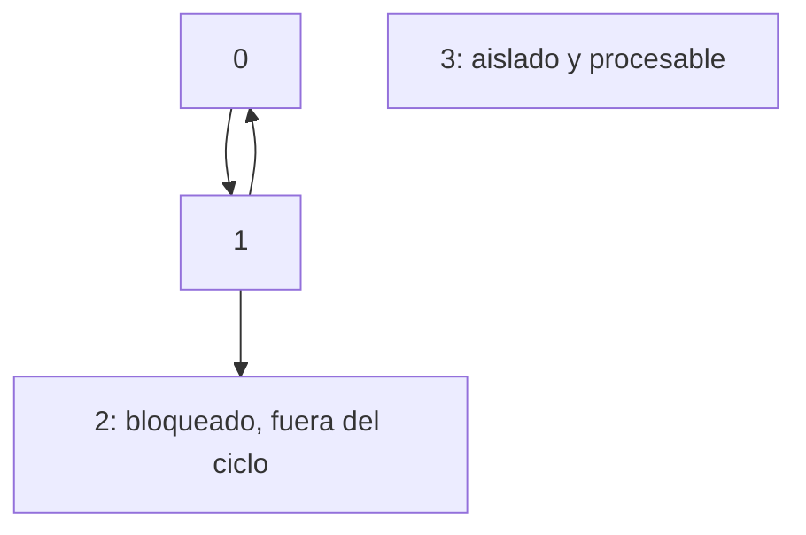

# Contar dependencias pendientes y distinguir ciclo de bloqueo

[Lección](README.md) · [Índice del módulo](../README.md) · [Recorridos ejecutables](../../laboratorios/recorridos/README.md)

## 1. Declara qué representa un arco

u→v significa que u precede a v. El algoritmo devuelve una permutación de todos los vértices y exige posición(u)<posición(v) para cada arco. No exige que dos tareas consecutivas estén conectadas; tampoco calcula duración, planificación paralela ni ruta mínima.

La implementación [ordenTopologico](../../src/curso/Grafo.java) calcula grados en un arreglo local y usa una prioridad por número de vértice. No elimina aristas del grafo original. Repetir la consulta sobre el mismo DAG puede reconstruir la misma respuesta.

## 2. Sigue una frontera con empates y un aislado

El recorrido usa cinco vértices: dos arcos paralelos 0→2, otro 1→2 y 2→3. El vértice 4 está aislado. El grado inicial de 2 es 3: cada arco almacenado cuenta y cada uno se descuenta al recorrer la adyacencia.

| Retirado | Grado de 2 | Tareas listas después del paso | Explicación |
|---|---|---|---|
| Ninguno | 3 | 0, 1, 4 | Los tres tienen grado cero |
| 0 | 1 | 1, 4 | Se retiran sus dos arcos a 2 |
| 1 | 0 | 2, 4 | La prioridad elige 2 antes de 4 |
| 2 | 0 | 3, 4 | Se satisface la dependencia de 3 |
| 3 | 0 | 4 | El aislado sigue esperando por el desempate |
| 4 | 0 | Vacía | Se incluyeron los cinco |

La salida es [0,1,2,3,4]. Otros desempates podrían producir órdenes válidos diferentes. El recorrido comprueba además la propiedad de posiciones para cada arco, no solo igualdad con una lista.

## 3. No confundas todos los bloqueados con miembros de un ciclo

Considera 0→1, 1→0, 1→2 y un vértice 3 aislado. Solo 3 empieza listo. Al procesarlo, 0 y 1 siguen dependiendo entre sí; 2 también queda bloqueado, aunque no haya un camino que regrese desde 2 y forme un ciclo con él.



La diferencia entre cantidad procesada y V demuestra que no hay orden completo. No identifica por sí sola todos los miembros de los ciclos. Para obtener ese diagnóstico haría falta otro procedimiento; el método actual rechaza con IllegalStateException.

## 4. Comprueba dominios y costos

```text
python scripts/recorridos.py topologico
```

El DAG vacío devuelve lista vacía. Un grafo no dirigido se rechaza. Un lazo dirigido es ciclo. Los pesos se ignoran, incluso si un arco tiene peso negativo válido para la representación: precedencia no usa Dijkstra.

Procesar grados y arcos cuesta O(V+E); la prioridad añade O(V log V). Una cola sin prioridad evitaría ese último término y cambiaría el desempate. Estas cuentas suponen el grafo representado y no incluyen renderizar una tabla o diagrama del resultado.

---

### ¿Necesitas apoyo con este tema?

Si te bloqueaste con la práctica, necesitas revisar tu entorno o adaptar lo aprendido a tu proyecto, podemos trabajarlo en una sesión personalizada.

[**Solicitar asesoría para este tema por WhatsApp**](https://wa.me/573103618296?text=Hola%2C%20Leli.%20Estoy%20estudiando%2020%20%C2%B7%20Orden%20topol%C3%B3gico%20y%20dependencias%20del%20curso%20Estructuras%20de%20Datos%20desde%20los%20fundamentos%20%28https%3A%2F%2Fgithub.com%2Flelyliliana%2FCurso-Estructura-de-Datos%2Fblob%2Fmain%2Fmodulo05%2F20-orden-topologico%2FREADME.md%29%20y%20necesito%20una%20asesor%C3%ADa%20personalizada.%20Mi%20duda%20es%E2%80%A6)
